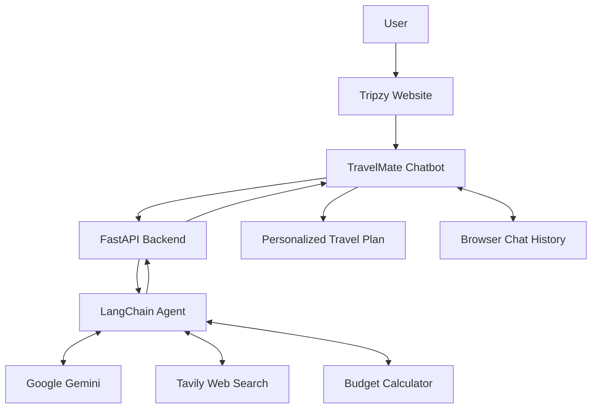

# 🌍 Tripzy — Har Safar, Smart Safar

### Experience Incredible India. Plan Smarter with TravelMate AI.

Tripzy is an AI-powered smart tourism platform designed to simplify travel planning, destination discovery, hotel exploration and local guide discovery across India.

Tripzy integrates TravelMate AI, an intelligent conversational travel assistant powered by LangChain, Google Gemini, Tavily and FastAPI.

---

## 🚀 Live Website

- **Website:** https://tripzy-travelmate.onrender.com/
- **AI Travel Assistant:** https://tripzy-travelmate.onrender.com/chatbot.html
- **Backend Health:** https://tripzy-travelmate.onrender.com/api/health
- **API Documentation:** https://tripzy-travelmate.onrender.com/docs

### Our Solution

Tripzy brings travel-related services into a single intelligent platform, helping travellers discover destinations, explore accommodation, find local guides and create personalized, budget-aware travel plans.

---

## ✨ Key Features

- AI-powered travel assistant
- Personalized trip planning
- Web-based travel research
- Transportation comparison
- Hotel and accommodation discovery
- Tourist attraction recommendations
- Intelligent budget optimization
- Day-by-day itinerary generation
- Conversation context and chat history
- Multilingual interface examples
- Local guide discovery
- Responsive user interface
- Cultural and food discovery
- Travel safety and SOS demonstration

---

## 🤖 TravelMate AI

TravelMate AI is an intelligent conversational travel assistant that helps users plan personalized trips according to their destination, budget, duration and travel preferences.

### Core Capabilities

| Capability | Description |
|---|---|
| Transportation | Compare flights, trains and buses |
| Accommodation | Research suitable hotels and stays |
| Sightseeing | Discover tourist attractions and experiences |
| Budget Optimization | Calculate expenses and recommend affordable alternatives |
| Conversation Context | Retain recent conversation details |
| Web Research | Retrieve current information using Tavily |
| Itinerary Generation | Create personalized day-by-day travel plans |

TravelMate uses a single LangChain agent with specialized tools and instructions.

---

## 🛠️ Technology Stack

| Technology | Purpose |
|---|---|
| HTML5 | Website structure |
| CSS3 | Styling and responsive design |
| JavaScript | Frontend functionality |
| Python 3.11 | Backend development |
| FastAPI | REST API |
| LangChain | AI agent framework |
| Google Gemini | Large language model |
| Tavily API | Web search and travel research |
| LangSmith Studio | Agent prototyping and development |
| Uvicorn | Python application server |
| GitHub | Source code management |
| Render | Cloud deployment |

---

## 🧠 System Architecture



---

## ⚙️ How TravelMate Works

1. The user enters travel requirements.
2. The frontend sends the request to the FastAPI backend.
3. The LangChain agent processes the request.
4. Google Gemini understands the user's requirements.
5. Tavily retrieves relevant travel information when needed.
6. The budget calculator validates estimated expenses.
7. TravelMate generates a personalized travel plan.
8. The response is displayed in the chatbot interface.
9. Recent conversation messages support follow-up questions.

---

## 💬 Example Prompts

### Complete Trip Planning

> Plan a 5-day trip from Ahmedabad to Manali for 3 people within ₹35,000.

### Budget Optimization

> Reduce my previous trip budget to ₹25,000 without changing the destination or number of travellers.

### Transportation Comparison

> Compare trains, buses and flights from Ahmedabad to Goa.

### Hotel Research

> Find three budget hotels in Manali under ₹2,000 per night with source links.

### Conversation Memory

> What is my destination, budget and number of travellers?

---

## 📂 Project Structure

```text
TravelMate/
│
├── index.html
├── explore.html
├── hotels.html
├── guides.html
├── guide-profile.html
├── trip-planner.html
├── about.html
├── contact.html
├── chatbot.html
│
├── css/
│   ├── style.css
│   ├── pages.css
│   └── chatbot.css
│
├── js/
│   ├── data.js
│   ├── script.js
│   └── chatbot.js
│
├── assets/
│   └── logo/
│       └── favicon.svg
│
├── server.py
├── requirements.txt
├── .python-version
├── .gitignore
├── PHOTO-CREDITS.md
└── README.md
```

---

## 💻 Local Installation

### 1. Clone the Repository

```bash
git clone https://github.com/XYZ-4444/TravelMate.git
cd TravelMate
```

### 2. Create Virtual Environment

```bash
python3.11 -m venv .venv
```

### 3. Activate Virtual Environment

macOS / Linux:

```bash
source .venv/bin/activate
```

Windows PowerShell:

```powershell
.\.venv\Scripts\Activate.ps1
```

### 4. Install Dependencies

```bash
pip install -r requirements.txt
```

### 5. Configure API Keys

Obtain API keys from:

- Google AI Studio: https://aistudio.google.com/
- Tavily: https://app.tavily.com/

Configure the following environment variables privately on your server:

```text
GOOGLE_API_KEY
TAVILY_API_KEY
```

For macOS zsh:

```bash
read -rs 'GOOGLE_API_KEY?Google API key: '
export GOOGLE_API_KEY
printf '\n'

read -rs 'TAVILY_API_KEY?Tavily API key: '
export TAVILY_API_KEY
printf '\n'
```

Never expose API keys in frontend code or commit them to GitHub.

### 6. Run the Backend

```bash
python -m uvicorn server:app --host 127.0.0.1 --port 8000
```

### 7. Open the Website

```text
http://127.0.0.1:8000/
```

### Open TravelMate AI

```text
http://127.0.0.1:8000/chatbot.html
```

The connected AI chatbot requires a running backend and internet connectivity.

---

## 🔌 API Endpoints

| Method | Endpoint | Description |
|---|---|---|
| GET | `/` | Tripzy homepage |
| GET | `/chatbot.html` | TravelMate chatbot |
| GET | `/api/health` | Backend health check |
| POST | `/api/chat` | Generate AI response |
| GET | `/docs` | Swagger API documentation |

### Example API Request

```json
{
  "message": "Plan a trip to Manali",
  "history": []
}
```

### Example API Response

```json
{
  "reply": "Here is your personalized travel plan..."
}
```

---

## ☁️ Cloud Deployment

The application is deployed using a Render Web Service connected to GitHub.

### Deployment Configuration

| Setting | Value |
|---|---|
| Platform | Render |
| Runtime | Python 3.11 |
| Service Type | Web Service |
| Branch | main |
| Build Command | pip install -r requirements.txt |

### Start Command

```bash
uvicorn server:app --host 0.0.0.0 --port $PORT --workers 1
```

### Environment Variables

- GOOGLE_API_KEY
- TAVILY_API_KEY

All sensitive credentials are maintained on the backend.

---

## 🔐 Security

- Server-side API key management
- Environment variable protection
- Basic API rate limiting
- Request validation
- Error handling
- Git ignore configuration
- No API keys embedded in frontend JavaScript

Production deployment would require stronger abuse prevention, authentication and provider usage controls.

---

## 🎯 Project Objectives

- Simplify travel planning using artificial intelligence.
- Promote Indian tourism and cultural heritage.
- Improve visibility for local hotels and guides.
- Reduce travel planning complexity.
- Help travellers make budget-aware decisions.
- Provide a unified tourism experience.
- Improve accessibility through responsive and multilingual interfaces.

---

## 📈 Expected Impact

- Reduced travel planning effort
- Improved destination discovery
- Better travel budget management
- Increased visibility for local businesses
- Personalized tourism experiences
- Greater awareness of Indian cultural heritage

These are intended project outcomes, not measured results.

---

## 🔮 Future Enhancements

- Independent multi-agent AI architecture
- Live flight and train booking APIs
- Real-time hotel availability
- Google Maps integration
- Real-time weather forecasting
- Firebase authentication
- Persistent database integration
- Voice-enabled AI travel assistant
- AI-powered travel recommendations
- Secure online payments
- Multilingual AI conversations
- Operational emergency assistance
- Android and iOS applications

---

## ⚠️ Demo Limitations

- Hotel and guide listings include illustrative data.
- The original trip planner uses a rules-based itinerary system.
- TravelMate provides AI-generated recommendations and web-based research, not guaranteed live booking availability.
- Booking and SOS features are demonstrations.
- Conversation context is based on browser history and recent messages supplied to the backend.
- External AI services require valid API keys and available quota.
- Render free-tier services may experience cold-start delays.
- Successful cloud AI responses after the previously encountered Gemini rate-limit error still require verification.

---

## 👨‍💻 Development Team

**Team Tripzy**

Developed as a smart tourism innovation and hackathon project.

### Project Domains

- Artificial Intelligence
- Generative AI
- Web Development
- Agentic AI
- Smart Tourism
- Cloud Computing

---

## 🌟 Project Vision

To transform the Indian tourism experience through intelligent technology, accessible travel planning and personalized AI assistance while supporting local businesses and cultural heritage.

---

# Tripzy

### Har Safar, Smart Safar 🇮🇳

**Discover India. Travel Smarter. Experience More.**

Made for innovation, tourism and a smarter future.
